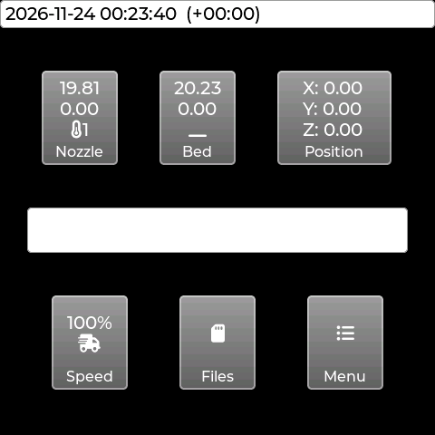
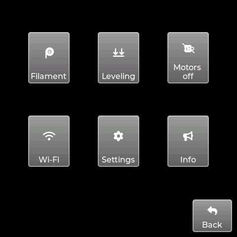
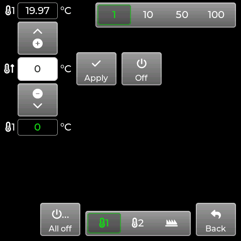
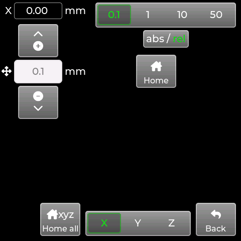

# Guition ESP32-S3-4848S040 (target `ESP32S3_4848S040C`)

4.0" 480x480 IPS capacitive touch panel ("86 box" wall panel form factor).

| Item | Detail |
| --- | --- |
| Module | ESP32-S3, 16MB quad flash, 8MB octal PSRAM |
| Display | ST7701S, 16-bit RGB565 parallel bus, set up over 3-wire 9-bit SPI |
| Touch | GT911 on I2C (SDA GPIO19, SCL GPIO45), INT/RST not connected |
| Backlight | GPIO38, PWM, active high |
| microSD | SPI: CS GPIO42, MOSI GPIO47, CLK GPIO48, MISO GPIO41 |
| Printer serial | UART0: TX GPIO43, RX GPIO44 on connector P1 (and header H1) |
| USB-C | CH340 USB-serial on UART0 (flashing, power) |

The ST7701S init SPI (CS GPIO39, SCL GPIO48, SDA GPIO47) shares SCL/SDA with
the microSD bus. It is only used once at boot; the panel CS is then held high.

A microSD card is optional. Without it the firmware runs normally and uses the
internal flash filesystem; with it you can store G-code to stream to the
printer and update firmware from the card.

The ESP32-S3 USB pins (GPIO19/20) are used by touch and the RGB bus, so this
board cannot use the ESP3D-TFT USB-OTG serial mode. To drive a printer that
only accepts G-code on USB, use the
[USB host bridge](../../tools/usb_host_bridge/README.md).

## User interface

The Marlin UI on this 480x480 screen labels every button with a caption under
its symbol (`ESP3D_BUTTON_CAPTIONS` in
`main/display/3dprinter/marlin/res_480_480/esp3d_styles_res.h`). Captions
come from the translation table (`caption_*` labels), so language packs can
translate them.

| Main | Menu | Temperatures | Positions |
| --- | --- | --- | --- |
|  |  |  |  |

Screens captured with `GET /snapshot` (see [remote screen](../remote-screen.md)).

## Build

Select `ESP32S3_4848S040C` in `CMakeLists.txt` (or pass
`-DESP32S3_HMI43V3=OFF -DESP32S3_4848S040C=ON`), then:

```bash
idf.py set-target esp32s3
idf.py build
idf.py -p /dev/ttyUSB0 -b 460800 flash
```

Use 460800 baud or lower to flash through the on-board CH340; 921600
corrupted reads on the board this was brought up on.

## Power

Power the board from its USB-C port. The P1 `+5V` pin feeds the same 5V rail
with no bulk capacitance and is known to cause resets; do not power both at
once. Use P1 only for TX/RX/GND.

## Connecting a printer

UART0 is the printer link (115200 baud by default; change it with
`[ESP901]<baud>` or in the settings screen). It is shared with the on-board CH340, so do not
flash or open the USB serial port while a printer is wired to P1.

### Elegoo Neptune 3 Pro (stock firmware)

The Neptune 3 Pro (ZNP Robin Nano_DW V2.2, STM32F401) only accepts G-code on
its USB port (CH340G on USART1, 115200 baud). Its screen port (RJ11, USART6)
speaks the TJC screen protocol, and the spare `J17` "WiFi" header (USART2) is
not a G-code port in the stock firmware.

Use an ESP32-S3-DevKitC-1 running the [USB host bridge](../../tools/usb_host_bridge/README.md):

```
Neptune 3 Pro USB-B ──USB cable + OTG adapter──> DevKitC-1 "USB" port
DevKitC-1 GPIO17 (TX) ──> display P1 RX
DevKitC-1 GPIO18 (RX) <── display P1 TX
DevKitC-1 GND ────────── display P1 GND
```

- Display: powered from its USB-C.
- Bridge: powered from its "UART" USB port.
- Printer: stock firmware, 115200 baud. The bridge never toggles DTR, which on
  this board is wired to the STM32 reset, so connecting or restarting the
  bridge does not reset the printer.
