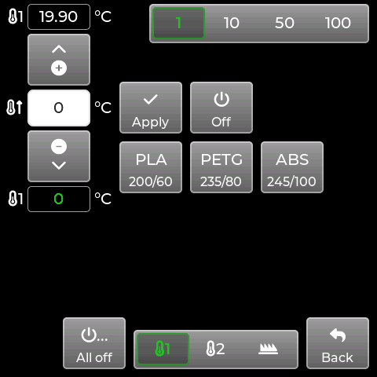

# Preheat presets

On resolutions that enable `ESP3D_PREHEAT_PRESETS` (currently the 480x480
Marlin UI), the temperatures screen shows three preheat buttons under
*Apply* / *Off*. Each shows the material name with `hotend/bed` as its caption.



A tap sets the selected extruder (extruder 0 when the bed is selected) and
the bed:

```
M104 T0 S200
M140 S60
```

and the status bar shows "Preheating PLA".

## Editing

Presets are settings in the form `name,hotend,bed` (name up to 8 characters,
hotend 0-300 °C, bed 0-150 °C). Edit them in **Settings → Preset 1/2/3**, or
remotely:

```
[ESP401]P=57 T=S V=PLA,200,60
[ESP401]P=58 T=S V=PETG,235,80
[ESP401]P=59 T=S V=TPU,220,50
```

Values outside the ranges, or not in that form, are rejected.

| Preset | Default |
| --- | --- |
| 1 | PLA, 200 °C, 60 °C |
| 2 | PETG, 235 °C, 80 °C |
| 3 | ABS, 245 °C, 100 °C |
